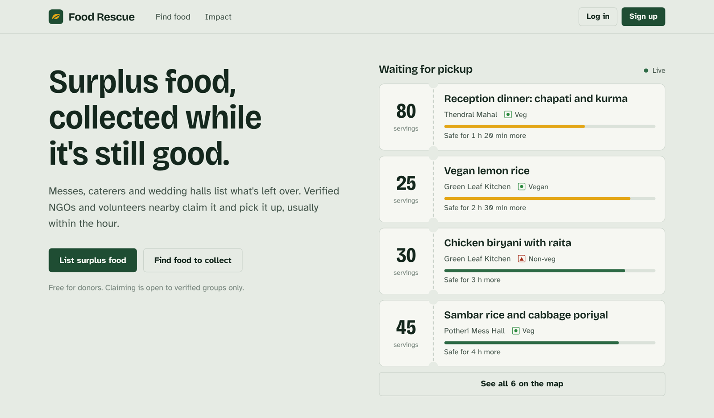
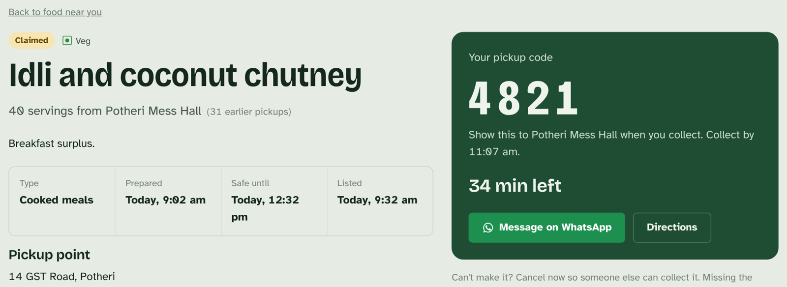
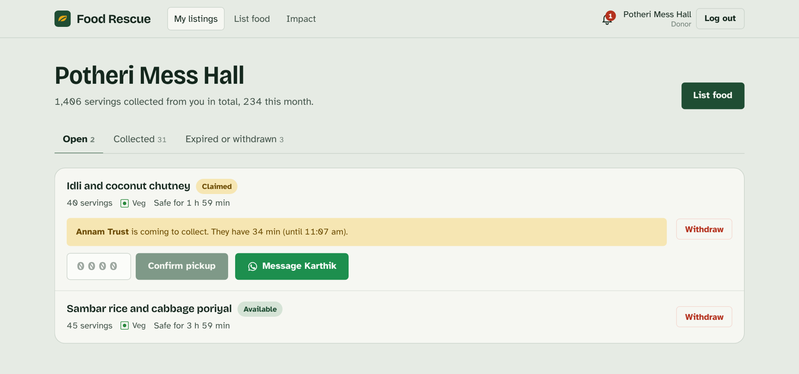
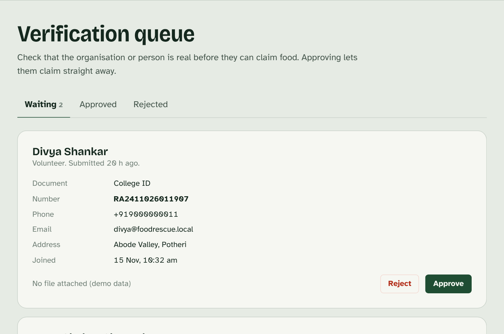
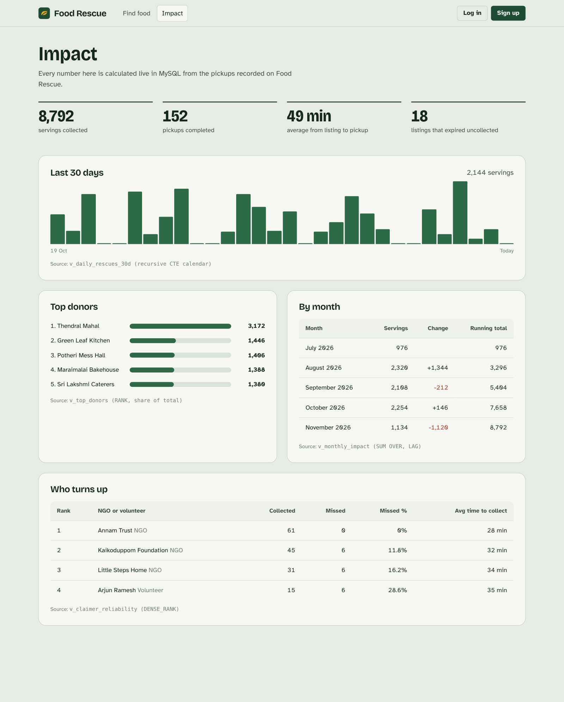
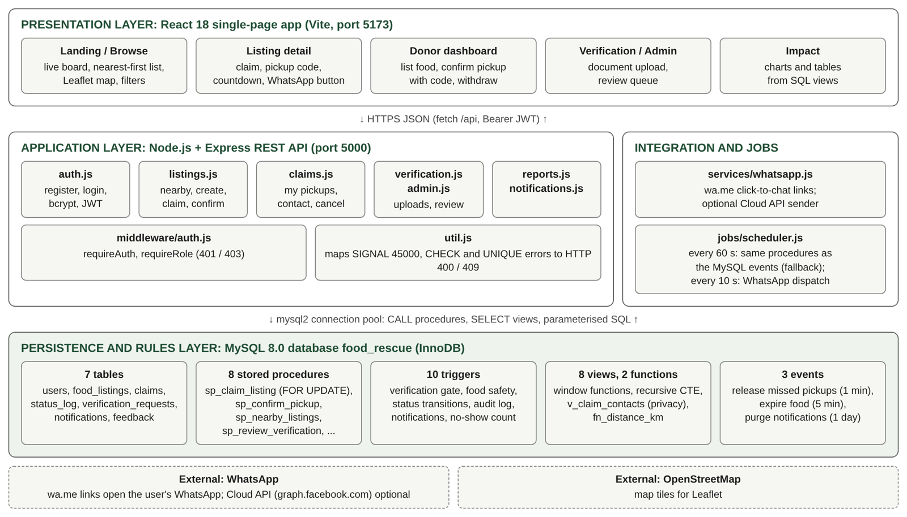

# Food Rescue

**Surplus food, collected while it's still good.**

Food Rescue is a web platform that connects kitchens with surplus food (hostel messes, caterers, wedding halls, bakeries) to **verified NGOs and volunteers** nearby, so that good food is eaten instead of thrown away.

> This project was built for my **Advanced SQL (ASQL)** subject.



---

## The problem

Every day, kitchens around campus finish with cooked food that is still safe to eat, while shelters and community kitchens a few kilometres away are short of meals. The food gets thrown away because there is no quick, trustworthy way to:

- tell nearby groups that the food exists,
- decide **who** gets it, without promising the same food to two groups,
- make sure the receiver is a genuine organisation, and
- hand it over before it stops being safe.

## How Food Rescue works

1. **A donor lists the food:** what it is, how many people it feeds, veg / non-veg / vegan, when it was made and until when it is safe, and a pin on the map.
2. **Verified NGOs and volunteers nearby see it**, closest first, with a meter showing how long it stays safe.
3. **The first group to claim it gets it**, together with a 4-digit **pickup code** and a deadline. If several groups press *Claim* at the same moment, exactly one wins.
4. **The group collects the food from the donor.** There are no delivery partners. Both sides message each other on **WhatsApp** in one click, with the details already written.
5. **The donor enters the pickup code** to confirm the handover.
6. If the group doesn't arrive in time, the food goes **back on the map automatically**. Three missed pickups pause that account for 24 hours.

| Claimed food with pickup code and WhatsApp | Donor confirming the pickup |
|---|---|
|  |  |

| Admin verification queue | Impact report from SQL views |
|---|---|
|  |  |

---

## Why this is an Advanced SQL project

The business rules live **inside MySQL 8**, not in application code. That means they hold for every client (the web app, MySQL Workbench, or anything else), and a bug in the API cannot break them.

| Object | Count | Examples |
|---|---|---|
| Tables | 7 | users, food_listings, claims, status_log, verification_requests, notifications, feedback |
| Triggers | 10 | Verification gate, food-safety windows, legal status transitions, audit log, notifications, no-show counting |
| Stored procedures | 8 | `sp_claim_listing`, `sp_confirm_pickup`, `sp_nearby_listings`, `sp_review_verification`, `sp_release_missed_pickups` |
| Stored functions | 2 | `fn_distance_km`, `fn_claim_block_reason` |
| Views | 8 | `v_claim_contacts` (privacy), `v_monthly_impact`, `v_daily_rescues_30d`, `v_top_donors` |
| Scheduled events | 3 | Release missed pickups every minute, expire unsafe food every 5 minutes |
| CHECK constraints | 16 | Phone format, servings, time windows, pickup code, review consistency |

**Highlights**

- **Concurrency-safe claims.** `sp_claim_listing` runs a transaction that locks the listing with `SELECT ... FOR UPDATE`. A stored **generated column** `active_listing_id = IF(status='active', listing_id, NULL)` with a **UNIQUE** index adds a second guarantee: at most one active claim per listing.
- **Rules in triggers.** Unverified or suspended users cannot claim, even with a direct `INSERT`. Food with under 60 minutes of safe time, or cooked food older than 12 hours, cannot be listed.
- **Error handling.** `DECLARE EXIT HANDLER ... ROLLBACK; RESIGNAL;` in every write procedure, and `SIGNAL SQLSTATE '45000'` with messages that the app shows to the user as-is.
- **Cursors.** `sp_release_missed_pickups` releases each missed claim in its own short transaction.
- **Window functions and CTEs.** `RANK`, `DENSE_RANK`, `NTILE`, `LAG`, running `SUM() OVER`, and a **recursive CTE** that builds a 30-day calendar so that days with zero rescues still appear.
- **Spatial search.** `ST_Distance_Sphere` behind an index-friendly bounding box on `(lat, lng)`.
- **Privacy through a view.** Phone numbers are read only from `v_claim_contacts`, which contains active claims only.

The full list, with where and why each feature is used, is in [docs/SQL_FEATURES.md](docs/SQL_FEATURES.md).



---

## Tech stack

| Layer | Technology |
|---|---|
| Database | MySQL 8.0 (InnoDB) |
| API | Node.js 18+, Express 4, mysql2, JWT, bcrypt, multer |
| Web app | React 18, Vite 5, React Router, Leaflet + OpenStreetMap |
| Messaging | WhatsApp click-to-chat (`wa.me`), optional WhatsApp Business Cloud API |

## Run it locally (Windows)

You need **Node.js 18+** and **MySQL 8.0**.

**Easiest:** double-click **`start-food-rescue.bat`**. The first time, it asks for your MySQL root password, installs the packages and creates the database with demo data. Then it opens http://localhost:5173. Keep the window open while you use the app.

**Manual:**

```bash
npm run setup                          # install packages for the API and the web app
copy server\.env.example server\.env   # then set DB_PASSWORD in server\.env
npm run db:setup                       # create the food_rescue database with demo data
npm run dev                            # API on :5000, web app on :5173
npm test                               # 31 end-to-end checks (run right after db:setup)
```

To load fresh demo data before a review, run `reset-demo-data.bat` or `npm run db:setup`.

### Demo accounts

All passwords are `password123`. The login page has one-click buttons for these accounts.

| Role | Email |
|---|---|
| Donor | `mess@foodrescue.local` (has a pickup waiting: code **4821**) |
| NGO | `annam@foodrescue.local` |
| Volunteer | `arjun@foodrescue.local` |
| Volunteer, not verified | `divya@foodrescue.local` |
| Admin | `admin@foodrescue.local` |

## Project structure

```
food_rescue/
├── db/                  MySQL scripts, run in order by npm run db:setup
│   ├── 01_schema.sql           tables, keys, CHECK constraints, indexes, generated column
│   ├── 02_functions_views.sql  stored functions, views (window functions, CTEs)
│   ├── 03_triggers.sql         business rules, audit log, notifications
│   ├── 04_procedures.sql       claim, confirm, cancel, review, nearby, housekeeping
│   ├── 05_events.sql           scheduled jobs
│   ├── 06_seed.sql             demo data (history generated with a recursive CTE)
│   └── 07_demo_queries.sql     queries to run during the review
├── server/              Express API (routes, WhatsApp service, scheduler, tests)
├── client/              React app
└── docs/                project documents and report
```

## Documents

| Document | Contents |
|---|---|
| [ARCHITECTURE.md](docs/ARCHITECTURE.md) | Components, claim sequence, listing life cycle, security |
| [DATABASE.md](docs/DATABASE.md) | ER diagram, every table and column, constraints, indexes |
| [SQL_FEATURES.md](docs/SQL_FEATURES.md) | Every advanced SQL feature used, and likely viva questions |
| [API.md](docs/API.md) | All REST endpoints and who may call them |
| [WHATSAPP.md](docs/WHATSAPP.md) | Click-to-chat links and optional Cloud API setup |
| [USER_GUIDE.md](docs/USER_GUIDE.md) | Using the app, and an 8-minute demo script |

## Troubleshooting

| Problem | Fix |
|---|---|
| `MySQL rejected the username or password` | Check `DB_USER` and `DB_PASSWORD` in `server/.env` |
| `Could not reach MySQL` | Start the MySQL80 service |
| `localhost refused to connect` | The app isn't running yet: start it and wait for "Starting Food Rescue" |
| Map is grey | Map tiles need an internet connection |
| Missed pickups are not released | Run `SET GLOBAL event_scheduler = ON;` (the API also runs the job every minute) |
