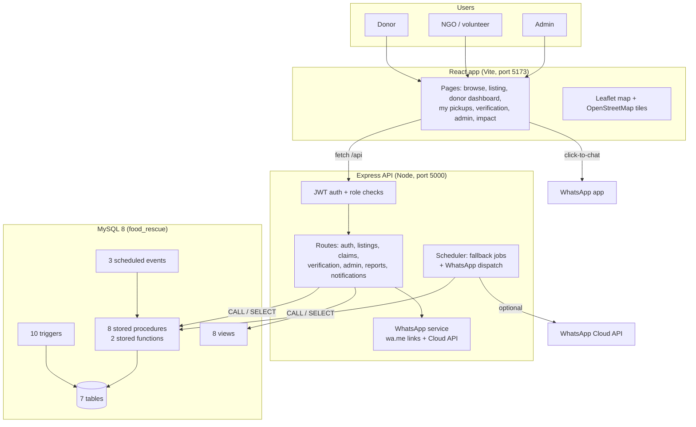
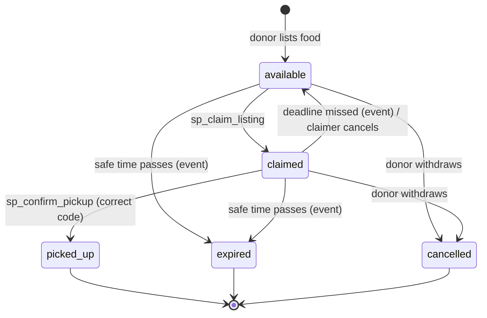

# Architecture

## Overview

Food Rescue has three tiers. MySQL holds the data **and** the rules, the Express API is a thin layer that authenticates users and calls the database, and the React app is the interface.



## Why the rules are in the database

The course is about advanced SQL, and putting rules in MySQL also makes them impossible to bypass.

| Rule | Where it is enforced | What happens if someone skips the API |
|---|---|---|
| Only verified NGOs/volunteers can claim | `trg_claims_bi` + `fn_claim_block_reason` | A direct `INSERT INTO claims` still fails |
| Only one active claim per listing | Generated column `active_listing_id` + `UNIQUE` | A second active row violates the index |
| Food must have 60+ minutes of safe time | `trg_listings_bi` | Direct inserts still fail |
| Status can only move forward | `trg_listings_bu` | e.g. `picked_up` → `available` is rejected |
| Every status change is logged | `trg_listings_au` | Logging cannot be forgotten |
| Missed pickups are released | `ev_release_missed_pickups` event | Runs even if the API is down |

The API's job is authentication, input shaping, file uploads, building WhatsApp messages and turning database errors into clean HTTP responses.

## Lifecycle of a listing



`trg_listings_bu` allows only these arrows.

## What happens when two NGOs claim at once

```mermaid
sequenceDiagram
    participant A as Annam Trust
    participant K as Kaikoduppom
    participant API as Express
    participant DB as MySQL

    A->>API: POST /listings/256/claim
    K->>API: POST /listings/256/claim
    API->>DB: CALL sp_claim_listing(256, 7, ...)
    API->>DB: CALL sp_claim_listing(256, 8, ...)
    Note over DB: Txn A: SELECT ... FOR UPDATE locks row 256
    Note over DB: Txn K: waits for the lock
    DB->>DB: A sees 'available', sets 'claimed', inserts claim, COMMIT
    Note over DB: Lock released; Txn K reads the row again
    DB-->>API: A: claim_id, pickup_code, deadline
    DB-->>API: K: SIGNAL 45000 "Someone else has already claimed this food"
    API-->>A: 201 Created + code
    API-->>K: 400 Bad Request
```

Even if two transactions somehow both got past the check, the second `INSERT` into `claims` would break `uq_claims_one_active`. The guarantee therefore has two layers.

The smoke test (`npm test`) fires four claims at the same instant and checks that exactly one succeeds.

## Pickup and WhatsApp

1. After a claim, the claimer's page shows the code, a countdown, a **Message on WhatsApp** button and **Directions**.
2. The API builds the button from `v_claim_contacts`. That view only contains **active** claims, and the route also filters by the logged-in user, so nobody can get a donor's number without holding the claim.
3. The donor's dashboard shows who is coming, a WhatsApp button to them, and a box for the pickup code.
4. `sp_confirm_pickup` checks the code and marks both the claim and the listing as done in one transaction.

## Background jobs

| Job | MySQL event | Also run by |
|---|---|---|
| Send 15-minute reminders, release missed pickups | `ev_release_missed_pickups` (every minute) | `server/src/jobs/scheduler.js` every minute |
| Expire food past its safe time | `ev_expire_listings` (every 5 minutes) | scheduler every minute |
| Delete old read notifications | `ev_purge_old_notifications` (daily) | none |
| Send WhatsApp copies of notifications | none | scheduler every 10 seconds (only if the Cloud API is configured) |

The procedures are idempotent, so running them from both MySQL and Node does no harm. The fallback exists because `event_scheduler` is sometimes off on student machines.

## Security

| Concern | Measure |
|---|---|
| Passwords | bcrypt hashes (cost 10); never returned by the API |
| Sessions | JWT signed with `JWT_SECRET`, 7-day expiry, sent as a `Bearer` header |
| Roles | `requireRole()` middleware on every protected route; procedures re-check ownership |
| Phone numbers | Exposed only through `v_claim_contacts` to the two parties of an active claim |
| Verification documents | Stored in `server/uploads`, served only to admins, PDF/JPG/PNG up to 5 MB |
| SQL injection | All queries use placeholders (`?`); no string-built SQL with user input |
| Business rules | Enforced in triggers and procedures, so a bug in the API cannot break them |

## Time zones

MySQL and Node run on the same laptop, so both use its local time (IST). If you run MySQL elsewhere, set `DB_TIMEZONE` in `server/.env` to the server's offset, for example `+05:30`.
