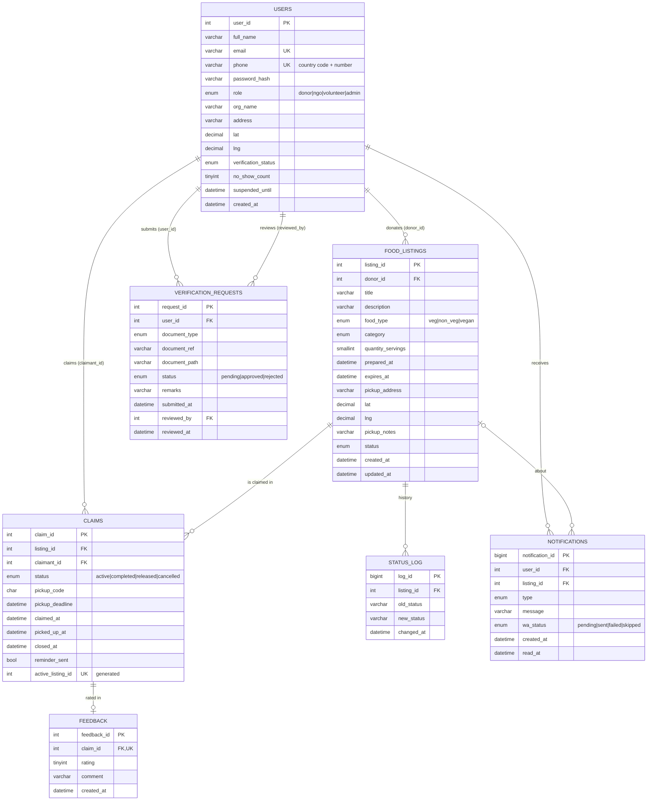

# Database design

Database: `food_rescue` on MySQL 8.0, InnoDB, `utf8mb4`.

| Object | Count | Names |
|---|---|---|
| Tables | 7 | users, food_listings, claims, status_log, verification_requests, notifications, feedback |
| Views | 8 | v_available_listings, v_claim_contacts, v_monthly_impact, v_daily_rescues_30d, v_top_donors, v_claimer_reliability, v_rescue_speed, v_platform_summary |
| Stored procedures | 8 | sp_claim_listing, sp_confirm_pickup, sp_cancel_claim, sp_cancel_listing, sp_review_verification, sp_nearby_listings, sp_expire_listings, sp_release_missed_pickups |
| Stored functions | 2 | fn_distance_km, fn_claim_block_reason |
| Triggers | 10 | see [SQL_FEATURES.md](SQL_FEATURES.md#triggers) |
| Events | 3 | ev_release_missed_pickups, ev_expire_listings, ev_purge_old_notifications |

## ER diagram

## Normalisation

The schema is in **third normal form**:

- Every table has a single-column surrogate key, and every non-key column depends on the whole key (2NF holds trivially).
- No transitive dependencies are stored. The donor's name is not copied into `food_listings`; it is joined from `users`. Distance is never stored; it is calculated by `fn_distance_km`.
- Donors, NGOs, volunteers and admins share one `users` table with a `role` column, because they share almost all attributes and log in the same way. Role-specific rules (an NGO must have `org_name`) are CHECK constraints.

Two deliberate exceptions:

- `food_listings.pickup_address/lat/lng` repeat the donor's address by default. A donor can list from a different place (a wedding hall, say), so this is a fact about the listing, not a copy.
- `claims.active_listing_id` is derived from `status` and `listing_id`. It is a **generated column** maintained by MySQL, so it can never be out of sync, and it exists only to enforce "one active claim per listing" with a UNIQUE index.

## Tables

### users

| Column | Type | Rules |
|---|---|---|
| user_id | INT UNSIGNED | PK, auto-increment |
| full_name | VARCHAR(100) | required |
| email | VARCHAR(150) | required, UNIQUE, `CHECK (email LIKE '%_@_%._%')`, lower-cased by trigger |
| phone | VARCHAR(15) | required, UNIQUE, `CHECK (phone REGEXP '^[0-9]{11,15}$')`. Stored with country code for wa.me |
| password_hash | VARCHAR(100) | bcrypt |
| role | ENUM | donor, ngo, volunteer, admin |
| org_name | VARCHAR(150) | required when role = 'ngo' (CHECK) |
| address, lat, lng | | lat in [-90, 90], lng in [-180, 180] (CHECK) |
| verification_status | ENUM | unverified, pending, verified, rejected. Set by triggers and `sp_review_verification` |
| no_show_count | TINYINT | +1 per missed pickup (trigger); reset after a suspension |
| suspended_until | DATETIME | set for 24 h after 3 missed pickups |

### food_listings

| Column | Type | Rules |
|---|---|---|
| listing_id | INT UNSIGNED | PK |
| donor_id | INT UNSIGNED | FK → users, ON DELETE RESTRICT. Trigger: must be a donor |
| title, description | VARCHAR | |
| food_type | ENUM | veg, non_veg, vegan |
| category | ENUM | cooked, packaged, bakery, raw, fruits_veg |
| quantity_servings | SMALLINT | CHECK 1 to 5000 |
| prepared_at, expires_at | DATETIME | CHECK expires_at > prepared_at; CHECK window ≤ 72 h; trigger: cooked food ≤ 12 h, and at least 60 min left when listed |
| pickup_address, lat, lng, pickup_notes | | |
| status | ENUM | available, claimed, picked_up, expired, cancelled. Transitions checked by `trg_listings_bu` |
| created_at, updated_at | DATETIME | `updated_at` uses ON UPDATE CURRENT_TIMESTAMP |

Indexes: `(status, expires_at)` for the available list and the expiry job; `(lat, lng)` for the bounding-box search; `(donor_id, created_at)` for the donor dashboard.

### claims

| Column | Type | Rules |
|---|---|---|
| claim_id | INT UNSIGNED | PK |
| listing_id | INT UNSIGNED | FK → food_listings (RESTRICT, because CASCADE is not allowed on a base column of a stored generated column) |
| claimant_id | INT UNSIGNED | FK → users. Trigger: must be a verified, non-suspended NGO/volunteer |
| status | ENUM | active, completed, released (missed deadline), cancelled |
| pickup_code | CHAR(4) | CHECK 4 digits |
| pickup_deadline | DATETIME | CHECK > claimed_at; never after the food's expires_at (procedure) |
| picked_up_at, closed_at | DATETIME | CHECK: completed ⇒ picked_up_at is set |
| reminder_sent | BOOLEAN | so the 15-minute reminder is sent once |
| active_listing_id | INT UNSIGNED | **STORED generated**: `IF(status='active', listing_id, NULL)`, **UNIQUE** |

Indexes: `(claimant_id, status)` for "My pickups"; `(status, pickup_deadline)` for the release job.

### status_log

An append-only audit trail written by `trg_listings_ai` and `trg_listings_au`. `changed_at` is `DATETIME(3)` (milliseconds), so changes made in the same second stay in order.

### verification_requests

| Column | Rules |
|---|---|
| document_type | ngo_registration, ngo_darpan (NGOs); govt_id, college_id (volunteers) |
| document_ref | the registration or ID number |
| document_path | file name in `server/uploads` |
| status | pending → approved / rejected, only via `sp_review_verification` |
| CHECK | `(status = 'pending') = (reviewed_at IS NULL)`: a reviewed request always has a review time |
| CHECK | rejected ⇒ remarks is set: a rejection always has a reason |

### notifications

Written by triggers and procedures. `wa_status` tracks the optional WhatsApp copy: `pending` → `sent` / `failed`, or `skipped` when the Cloud API is not configured.

### feedback

One rating (1 to 5) per completed claim: UNIQUE on `claim_id`, CHECK on `rating`, and a trigger that refuses feedback before pickup.

## Referential actions

| FK | ON DELETE | Why |
|---|---|---|
| food_listings.donor_id | RESTRICT | Keep the history of who donated |
| claims.listing_id | RESTRICT | Required by the generated column; listings are never deleted, only cancelled |
| claims.claimant_id | RESTRICT | Keep pickup history |
| status_log.listing_id | CASCADE | The log has no meaning without the listing |
| verification_requests.user_id | CASCADE | Documents belong to the user |
| verification_requests.reviewed_by | SET NULL | Keep the request if an admin account is removed |
| notifications.user_id | CASCADE | |
| notifications.listing_id | SET NULL | Keep the message text |
| feedback.claim_id | CASCADE | |
